# Technical Design Document: Hero Navigation Experience & State Architecture

- **Document:** `docs/designs/hero_navigation_experience.md`
- **Author:** Gemicia (for Danilo Andiel — Team AIisMyFriend)
- **Status:** RATIFIED & AUDITED (EGM Goldfish Review Passed with Mitigations)
- **Target Sprint:** Sprint-04 / Demo Day Escalation
- **Scope:** Front-end State Machine, Zero-Latency 1-Click Demo Pipeline, and Hero Showcase Component Contract.

---

## 1. Executive Summary & Problem Formulation

In competitive evaluation settings (such as the CodeSquad AI Sprint Demo Day), evaluators, mentors, and employers make baseline judgements within the first **2 to 3 seconds** of page landing.

The existing MVP architecture lands the user immediately on a 5-question intake form (`stage === 'intake'`). While functional and rubric-compliant, this front door presents two operational liabilities:
1. **Cognitive Load Barrier:** First-time visitors face a wall of form fields before understanding the application's unique value proposition ("Stop fearing replacement. Start steering the tools.").
2. **Demo Day Friction:** A judge testing 10+ student apps has zero patience to fill out forms or even look for a small "Load Demo" button tucked inside an intake header.

### Architectural Solution
Implement a high-impact, cinematic **Hero Stage** (`stage === 'hero'`) functioning as an architectural launchpad, governed by a deterministic Finite State Machine (FSM) with a **Zero-Latency 1-Click Evaluation Expressway** that executes the full Gemini 3.8 Flash pipeline directly from the Hero banner without touching the intake DOM.

---

## 2. Finite State Machine (FSM) Specification & Error Resilience

```mermaid
stateDiagram-v2
    [*] --> HERO : Page Load / Init
    HERO --> INTAKE : User clicks "Mapear Mis Habilidades" / Explore
    HERO --> LOADING : User clicks "⚡ Probar Perfil de Marcus (Demo Instantánea)"
    INTAKE --> HERO : User clicks Brand Logo / Back to Overview
    INTAKE --> LOADING : User submits custom 5-question profile
    LOADING --> RESULTS : AI Pipeline Success (200 OK + 3 Role Cards)
    LOADING --> HERO : Pipeline Error (if invoked from HERO; toast error shown)
    LOADING --> INTAKE : Pipeline Error (if invoked from INTAKE)
    RESULTS --> INTAKE : User clicks "Ajustar Mi Enfoque" (Preserves form data)
    RESULTS --> HERO : User clicks "Comenzar Nuevo Diagnóstico" (Resets form data)
```

### State Definitions & Invariants

| State | Screen / Component | Invariant State Conditions | Transitions Allowed |
| :--- | :--- | :--- | :--- |
| `HERO` | `<HeroSection />` | `formData` may be null or cached; `results` may be null. Persistent top nav active. | `INTAKE`, `LOADING` |
| `INTAKE` | `<QuestionnaireIntake />` | `formData` binds to active inputs; validation errors reset on keystroke. | `HERO`, `LOADING`, `RESULTS` (if unedited) |
| `LOADING` | `<LoadingTransition />` | API request inflight; UI cycling progress messages every 2.2s. Cascade timeout capped at 9s/tier. | `RESULTS`, `HERO`/`INTAKE` (on error) |
| `RESULTS` | `<RoleDeck />` | `results` contains exactly 3 role cards, O*NET codes, workflows, human edge & prompts. | `INTAKE`, `HERO` |

---

## 3. The 1-Click Demo Pipeline (Marcus Expressway & Golden Master Cushion)

### The Contradiction & TRIZ Resolution
- Evaluators require instant gratification (under 1 click).
- Live AI execution introduces network and rate-limit risks during Demo Day.
- **Resolution (TRIZ Principles 4 & 10):**
  1. Single source of truth: `src/data/marcusProfile.js` exports `MARCUS_SAMPLE` and `MARCUS_GOLDEN_MASTER`.
  2. Concurrency guard: `HeroSection` disables button and shows inline spinner immediately upon click (`isSubmitting === true`), preventing double-clicks.
  3. Golden Master fallback cushion: If the live Gemini API fails (HTTP 429 / quota / offline), the client hydrates `MARCUS_GOLDEN_MASTER` into `RESULTS` with a non-blocking informative banner, ensuring judges never see a crashed screen.

---

## 4. Component Boundary Contract & Decoupling

Following the EGM Architecture Audit:
1. **`ProjectHeader.jsx` Refactor:** Stripped of all `.hero-banner` markup. Strictly serves as the sticky/top application navigation bar (interactive Brand Logo with `onLogoClick`, Team Badge, and Live Status Cluster).
2. **`HeroSection.jsx` Scope:** Owns the headline typography, dark mesh background, dual CTAs, live stats, and 3D perspective teaser card.
3. **Viewport Management:** Replaced static pixel offsets with deterministic top-aligned transitions (`window.scrollTo({ top: 0, behavior: 'smooth' })`).
4. **GPU Optimization:** `will-change: transform` scoped strictly to `:hover`, with `prefers-reduced-motion` safety fallback.

---

## 5. EGM Audit Resolutions & Executive Disposition

| Finding ID | Source | Description | Disposition | Implementation Plan |
| :--- | :--- | :--- | :--- | :--- |
| **EGM-01** | `egm-design` | Header layout schism & double H1 | **FIX-NOW** | Strip `.hero-banner` from `ProjectHeader.jsx`; delegate to `HeroSection.jsx`. |
| **EGM-02** | `egm-design` | Asymmetric error trap in Intake | **FIX-NOW** | Track `sourceStage`; route demo failures back to `hero` with alert or Golden Master. |
| **EGM-03** | `egm-design` | Interactive Brand Logo | **FIX-NOW** | Wrap `.brand` in semantic `<button>` with `onLogoClick` back to `HERO`. |
| **EGM-04** | `egm-design` | Fixture duplication | **FIX-NOW** | Centralize in `src/data/marcusProfile.js`. |
| **EGM-05** | `egm-design` | Inflight double-click hazard | **FIX-NOW** | Guard dispatch with `isSubmitting` and UI disabled state. |
| **EGM-06** | `egm-inventive` | Demo Day failure cushion | **FIX-NOW** | Hydrate Golden Master fallback if demo call fails. |
| **EGM-07** | `egm-inventive` | Contextual Anchor in RoleDeck | **FIX-NOW** | Render compact diagnostic summary chip in results header. |
| **EGM-08** | `egm-inventive` | Abstract CSS 3D Teaser | **FIX-NOW** | Pure CSS lightweight geometric skeleton, no duplicate HTML. |
